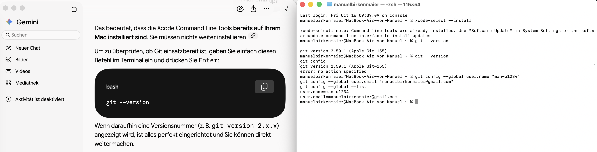

```{r setup, include=FALSE}
knitr::opts_chunk$set(echo = TRUE)

if("librarian" %in% installed.packages()==FALSE) install.packages("librarian")
librarian::shelf(knitr, prettydoc, ggplot2, cran_repo = 'https://cran.r-project.org')
```

# Installing Git on a Mac as a complete newbie

## Using Happygitwith R website

I read through the "Happy Git with R" Website and followed the steps on how to install Git. To be completely honest, some of the technical terms explaining the benefits of Git did not yet make a lot of sense to me but I am sure I will figure that out in the future.

## Using the MacTerminal with Gemini

As I am fairly new to coding in general I used Gemini to guide me through the commands in the terminal / shell.

```{r, echo=FALSE, fig.cap="Das ist mein Screenshot", out.width="80%", fig.align="center"}

```

With that help I manageg to install Git.


## Creating the PAT (personal access token)

following the instruction on the `HappyGitWithR` website, the set up was
actually pretty straight forward.

## Introducing yourself to Git

## Making sure you can talk to Github and Github can talk to you


## R Markdown

This is an R Markdown document. Markdown is a simple formatting syntax for authoring HTML, PDF, and MS Word documents. For more details on using R Markdown see <http://rmarkdown.rstudio.com>.

When you click the **Knit** button a document will be generated that includes both content as well as the output of any embedded R code chunks within the document. You can embed an R code chunk like this:

```{r cars}
summary(cars)
```

## Including Plots

You can also embed plots, for example:

```{r pressure, echo=FALSE}
plot(pressure)
```

Note that the `echo = FALSE` parameter was added to the code chunk to prevent printing of the R code that generated the plot.
